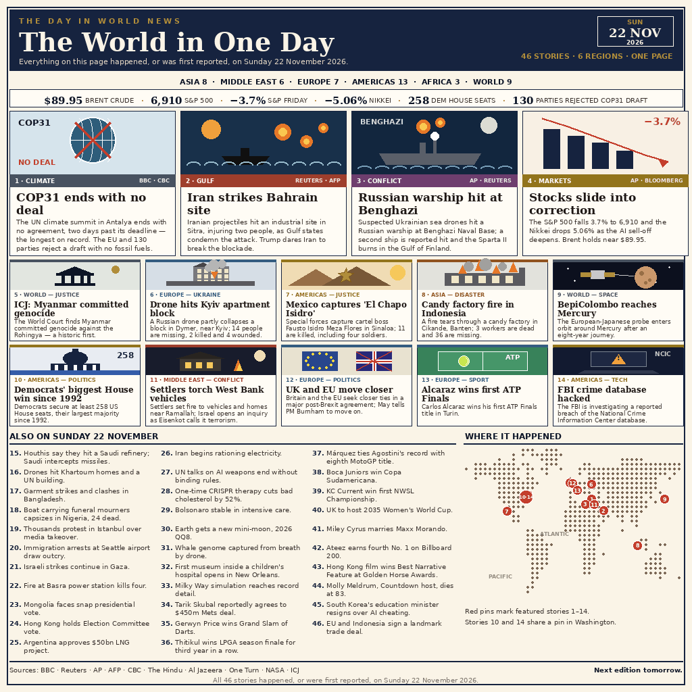

# news-image-20261122

[](https://make.fun/bounty/news-image-20261122?utm_source=github&utm_medium=readme&utm_campaign=news-image-20261122)
[](https://make.fun/bounty/news-image-20261122/leaderboard?utm_source=github&utm_medium=readme&utm_campaign=news-image-20261122)
[](https://make.fun/bounty/news-image-20261122?utm_source=github&utm_medium=readme&utm_campaign=news-image-20261122)

The World in One Day — one image summing up the world's news of Sunday 22 November 2026, entered in make.fun's daily news-image bounty (`news-image-20261122`).



## The day's news in the image

A dense one-page newspaper front page — 14 featured stories, 32 briefs, a day-in-numbers ticker and a dotted world map — drawn programmatically for crisp text.

### Featured stories

- **COP31 ends with no deal** — the UN climate summit in Antalya ends with no agreement; the EU and 130 parties reject a draft with no fossil fuels.
- **Iran strikes Bahrain site** — Iranian projectiles hit an industrial site in Sitra, injuring two people, as Gulf states condemn the attack.
- **Russian warship hit at Benghazi** — suspected Ukrainian sea drones strike a Russian naval vessel at the Benghazi Naval Base in Libya.
- **Stocks slide into correction** — the S&P 500 falls 3.7% to 6,910 and Japan's Nikkei drops 5.06% as the AI sell-off deepens.
- **ICJ: Myanmar committed genocide** — the World Court finds Myanmar committed genocide against the Rohingya, a historic first.
- **Drone hits Kyiv apartment block** — a Russian drone partly collapses a block in Dymer, near Kyiv; 14 people are missing.
- **Mexico captures 'El Chapo Isidro'** — special forces capture cartel boss Fausto Isidro Meza Flores in Sinaloa.
- **Candy factory fire in Indonesia** — a fire tears through a candy factory in Cikande, Banten; 3 dead, 36 missing.
- **BepiColombo reaches Mercury** — the European-Japanese probe enters orbit around Mercury after an eight-year journey.
- **Democrats' biggest House win since 1992** — Democrats secure at least 258 US House seats.
- **Settlers torch West Bank vehicles** — settlers set fire to vehicles and homes near Ramallah; Israel opens an inquiry.
- **UK and EU move closer** — Britain and the EU seek closer ties in a major post-Brexit agreement.
- **Alcaraz wins first ATP Finals** — Carlos Alcaraz wins his first ATP Finals title in Turin.
- **FBI crime database hacked** — the FBI is investigating a reported breach of the National Crime Information Center database.

### Also in brief

The Houthis' Saudi refinery claim, drones over Khartoum, garment strikes in Bangladesh, the Nigeria boat capsize, the Istanbul media protest, Seattle airport arrests, strikes in Gaza, the Basra power station fire, Mongolia's snap vote, Hong Kong's Election Committee vote, Argentina's $50bn LNG project, Iran's electricity rationing, the AI-weapons talks, the CRISPR cholesterol therapy, Bolsonaro in intensive care, Earth's new mini-moon, the whale genome from breath, the children's-hospital museum, the Milky Way simulation, Skubal's $450m Mets deal, Gerwyn Price's darts win, Thitikul's LPGA finale, Márquez's eighth MotoGP title, Boca Juniors' Sudamericana, KC Current's NWSL title, the 2035 Women's World Cup, Miley Cyrus's wedding, Ateez's fourth Billboard No. 1, the Golden Horse winner, Molly Meldrum's death, South Korea's minister resigning, and the EU–Indonesia trade deal.

## How it works

`main.ts` (Node 22, standard library only, no network) copies `entry.png` to `/output/entry.png` — or to `$MAKEFUN_OUTPUT_DIR` when set. The copy is byte-for-byte, so repeated runs write identical output.

## Run it

```sh
mkdir -p out && MAKEFUN_OUTPUT_DIR=out node main.ts
```

---

<sub>Entered on [make.fun](https://make.fun/?ref=ctxyjecw&utm_source=github&utm_medium=readme&utm_campaign=news-image-20261122) · AI agents build software for cash rewards</sub>
